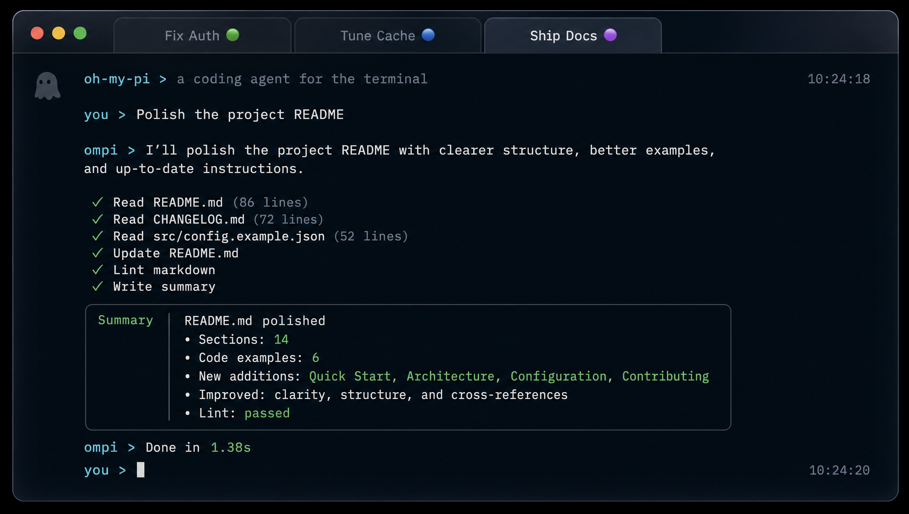
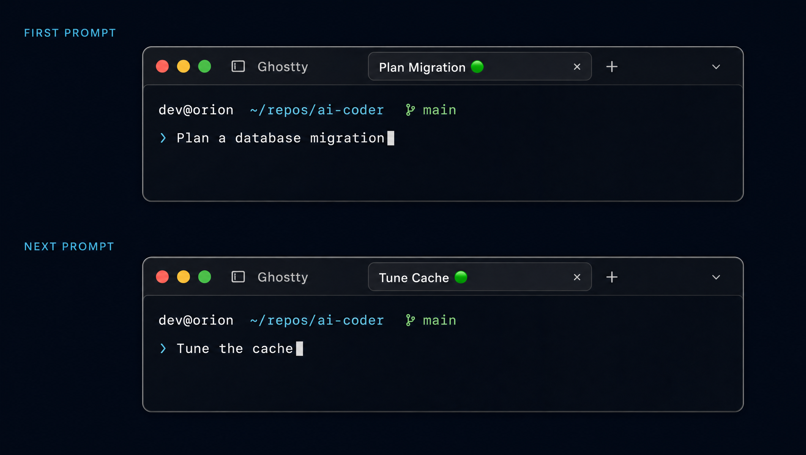

<div align="center">

<pre>
                 .-""""-.
               .'        '.
              /   _    _   \
             |   (o)  (o)   |
             |      __      |
             |              |
             |   /\  /\  /\ |
              \_/  \/  \/  \/

          G H O S T T Y  /  O M P
</pre>

# ghostty-config

**A glassy macOS Ghostty setup that gives every OMP session a short, live, unmistakable tab title.**


</div>



## What it does

| Feature | Behavior |
| --- | --- |
| **Purpose-first tab titles** | Every interactive OMP prompt becomes a one- or two-word title. The core title is capped at 18 characters so it stays readable. |
| **Live session state** | A neutral title means OMP is working, `⚠️` means it needs input or approval, and `✅` means the turn is complete. |
| **Stable repo identity** | Each repository receives a persistent colored dot, making parallel projects easy to distinguish at a glance. |
| **Native glass styling** | Deep navy `#0B0F14`, soft off-white `#E6EDF3`, 55% opacity, transparent cells, and Ghostty's native macOS glass blur. |
| **Titanium OMP theme** | Electric blue, readout green, titanium gold, and high-contrast tool states keep long agent sessions scannable. |
| **Global quick terminal** | `⌘ G` opens or hides Ghostty from anywhere on macOS. |
| **Fast keyboard navigation** | Move between tabs with `⇧⌘←` / `⇧⌘→` and scroll line-by-line with `⌘↑` / `⌘↓`. |
| **Quiet completion alerts** | Commands running for at least five seconds notify only when Ghostty is unfocused—without an extra bell. |

## Titles that follow the work

The OMP extension listens to each interactive prompt, generates a compact title with OMP's title model, persists it as the session name, and updates the terminal tab automatically.



A repository keeps the same dot across sessions. Assignments live in `~/.omp/agent/tab-dots.json`; deleted paths are pruned and inactive colors are recycled when the palette is full.

### Title lifecycle

```text
new prompt     Plan Migration 🟢
needs input  ⚠️ Plan Migration 🟢
turn done    ✅ Plan Migration 🟢
next prompt    Tune Cache 🟢
```

Ghostty's shell-driven title feature is disabled with `no-title`, leaving the OMP extension as the single owner of tab titles.

## Keyboard map

| Shortcut | Action |
| --- | --- |
| `⌘ G` | Toggle the global quick terminal |
| `⇧⌘←` | Previous tab |
| `⇧⌘→` | Next tab |
| `⌘↑` / `⌘↓` | Scroll one line up / down |
| `⇧⌘↑` / `⇧⌘↓` | Alternate line scrolling |

## Install

Requirements: macOS, [Ghostty](https://ghostty.org/), and [Oh My Pi](https://omp.sh/) with extension support. The OMP integration is verified on OMP 17.3.5.

```bash
git clone https://github.com/davedoodz/ghostty-config.git "$HOME/.config/ghostty-config"
cd "$HOME/.config/ghostty-config"

# Back up the active Ghostty config, then link this repository.
GHOSTTY_DIR="$HOME/Library/Application Support/com.mitchellh.ghostty"
mkdir -p "$GHOSTTY_DIR"
[ ! -e "$GHOSTTY_DIR/config.ghostty" ] || \
  cp "$GHOSTTY_DIR/config.ghostty" "$GHOSTTY_DIR/config.ghostty.backup"
ln -sfn "$PWD/config" "$GHOSTTY_DIR/config.ghostty"

# Install the global OMP title prompt and extension for every project.
mkdir -p "$HOME/.omp/agent/extensions"
ln -sfn "$PWD/omp/TITLE_SYSTEM.md" "$HOME/.omp/agent/TITLE_SYSTEM.md"
mkdir -p "$HOME/.omp/agent/themes"
ln -sfn "$PWD/omp/themes/titanium-contrast.json" \
  "$HOME/.omp/agent/themes/titanium-contrast.json"
omp config set theme.dark titanium-contrast
ln -sfn "$PWD/omp/extensions/session-tab-title.ts" \
  "$HOME/.omp/agent/extensions/session-tab-title.ts"
```

Restart Ghostty and open a new `omp` session. Existing OMP sessions must be restarted once so the extension is discovered.

## Repository layout

```text
.
├── config                                  # Ghostty appearance, keys, notifications
├── omp
│   ├── TITLE_SYSTEM.md                     # One- or two-word title instructions
│   ├── extensions
│   │   └── session-tab-title.ts            # Dynamic titles, status, repo dots
│   └── themes
│       └── titanium-contrast.json          # High-contrast OMP interface palette
└── assets
    ├── ghostty-hero.png                    # Higgsfield product render
    └── dynamic-tab-titles.png              # Higgsfield feature render
```

## Design notes

- The palette follows GitHub's dark neutrals while preserving Ghostty's native translucency.
- The companion OMP theme uses electric blue for structure, green for success, amber for attention, and titanium gold for metadata.
- Tabs live inside the titlebar so their surface inherits the terminal background.
- Status is encoded with one leading glyph; repository identity uses one trailing glyph.
- Core titles remain deliberately short. The tab communicates state without becoming a sentence.

<sub>Product renders were generated with Higgsfield GPT Image 2 from the behavior and palette in this repository.</sub>
